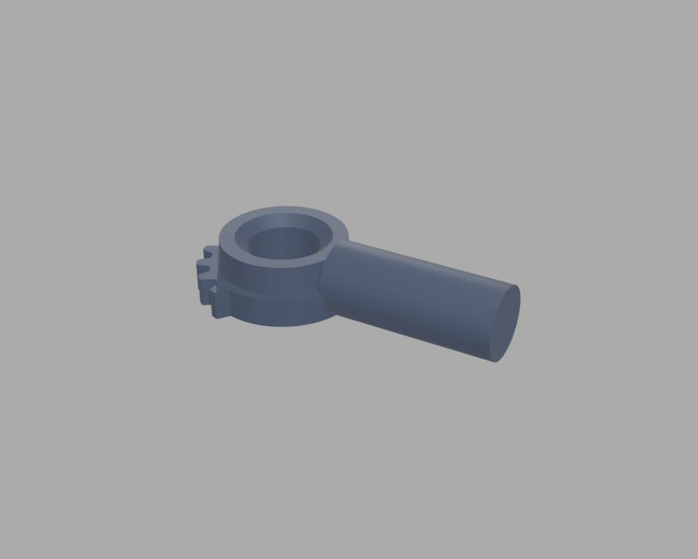
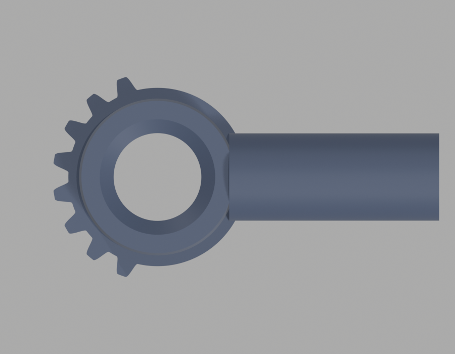
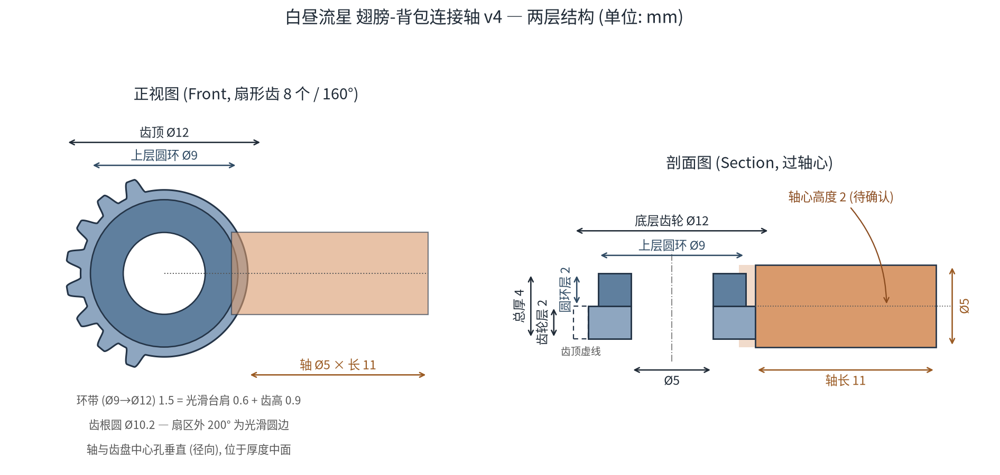
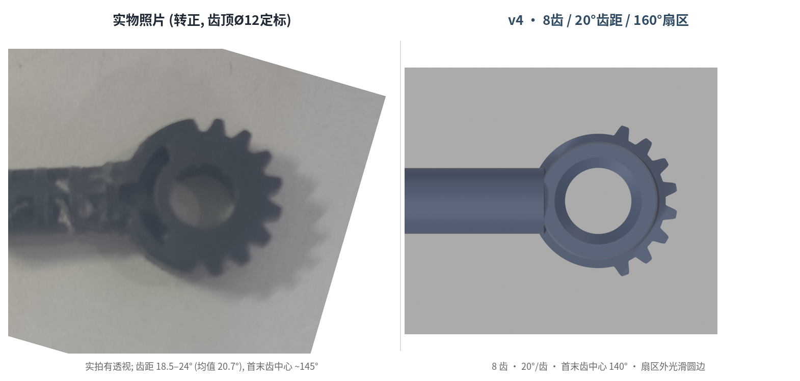
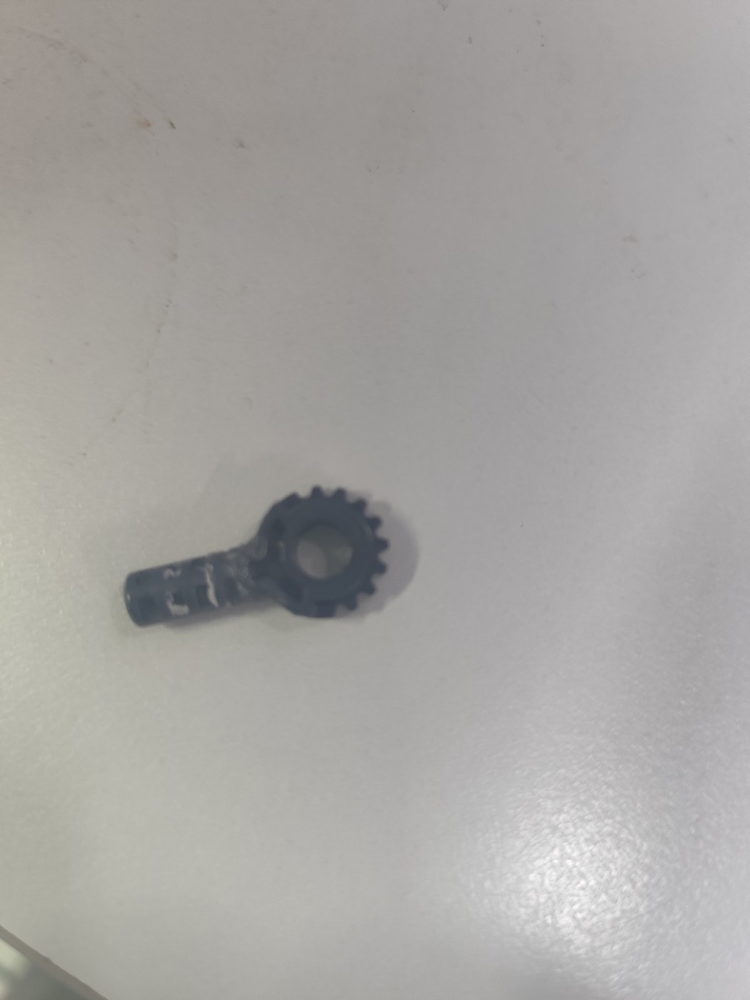

# 白昼流星 1/12 翅膀–背包连接轴 · 3D 打印替代件

# Wing ↔ Backpack Connector Shaft — SOULMOULD 白昼流星 1/12 (fan-made replacement)



塑灵模玩《白昼流星》1/12 拼装模型中，连接翅膀与背包的径向轴零件。官方不提供 STL，也没有单独补件，件丢了或断了只能按实物逆向。本仓库是**按照片逆向 + 实物打印验证过**的参数化模型，附带可直接打印的 STL。

Fan-made replacement for the wing-to-backpack connector shaft of the SOULMOULD (塑灵模玩) 《白昼流星》 1/12 plastic model kit. No official STL or spare part exists; this model was reverse-engineered from photos of the original part and **verified by an actual print**.

> ⚠️ 非官方配件，与塑灵模玩无关；仅供个人修复使用，禁止商用转售。
> Unofficial fan part, not affiliated with or endorsed by SOULMOULD. Personal repair use only.

---

## 打印验证结果 / Print-test result

| 版本 / Variant | 结果 / Result |
|---|---|
| **Ø5 整圆轴 + Ø5 孔**（`stl/` 里就是这一版）| ✅ 可装、不松动 — **推荐** / fits, no play — **use this one** |
| 轴上下切平到与圆环齐平 / shaft flattened flush with the ring | ❌ 装配后松动 / loose — 不要用 / do not use |

结论：**保留整圆 Ø5 轴**。轴切平后失去了圆柱配合面，装上去会晃；松紧不合适时只调孔径/轴径（见下方 “松紧微调”），不要切轴。

Keep the shaft fully round. The flattened variant was tested and is loose; tune the fit with the bore/shaft diameters instead of cutting the shaft.

---

## 尺寸 / Dimensions

单位 mm。所有数值由实物照片定标（齿顶圆 Ø12）并实测校准。

| 项目 / Item | 尺寸 / Size |
|---|---|
| 总厚 / total thickness | 4.0（底层齿轮 2.0 + 上层圆环 2.0 / gear 2.0 + upper ring 2.0）|
| 底层齿轮盘外径 / gear tip Ø (incl. teeth) | Ø12.0 |
| 上层圆环 / upper ring | Ø9.0 × 高 2.0，前脸孔口倒角 0.4 |
| 中心通孔 / center bore | Ø5.0 通孔 |
| 环带 / annular band Ø9→Ø12 | 1.5 = 光滑台肩 0.6 + 齿高 0.9 → 齿根 Ø10.2 |
| 齿 / teeth | **8 个，只在 160° 扇区内**，齿距 20°，首末齿中心相距 140°；扇区中心与轴相反；扇区外为光滑圆边 / 8 teeth inside a 160° sector, 20° pitch, opposite the shaft; smooth rim elsewhere |
| 径向轴 / radial shaft | Ø5.0 × 长 11.0，从齿根圆起算，与中心孔垂直，位于厚度中面（z = 2） |
| 包围盒 / bounding box | 22.04 × 11.43 × 5.00（轴比本体上下各凸出 0.5 / shaft protrudes 0.5 above and below the 4 mm stack）|
| 网格 / mesh | 8278 三角面，0 非流形边 / watertight, 0 non-manifold edges |

关键口径（来自实物）：底层大圆环**包含齿**是 Ø12；齿轮到小圆环的环带 = (12 − 9)/2 = 1.5。

---

## 打印建议 / Print settings

- **姿态 / orientation**：齿轮面朝下平放，轴水平。轴比本体上下各凸出 0.5 mm，圆盘底面会离床 0.5 mm —— **开支撑**（或加 0.5 mm 垫高层），否则圆盘首层悬空。 / Gear face down, shaft horizontal; the shaft is 0.5 mm proud of both faces, so support the disc's bottom face.
- **材料 / material**：PETG 或 PA-CF 推荐；PLA 偏脆，翅膀受力时轴根容易断。/ PETG or PA-CF; PLA is brittle at the shaft root.
- **层高 / layer height**：0.12–0.16 mm，壁厚 ≥ 3 圈。
- 这是细长悬臂件，**轴与 3/4 视角**见下图，打印后检查轴根无缺料。

### 松紧微调 / Fit tuning

打印件尺寸随机器和材料变化。装配太紧/太松时，用环境变量微调后重新生成，步长 0.05 mm：

| 现象 / Symptom | 调整 / Adjustment |
|---|---|
| 轴插不进孔 / shaft won't enter | `BORE_D` +0.05 或 `SHAFT_D` −0.05 |
| 装上松动 / loose in the socket | `BORE_D` −0.05 或 `SHAFT_D` +0.05 |

---

## 图片 / Images

| | |
|---|---|
|  |  |
| 顶视 / top view | 尺寸示意图（正视 + 剖面）/ dimension drawing |
|  |  |
| 实物照片 vs 模型（同比例）/ photo vs model, same scale | 实物背面 / original part, back side |

---

## 参数化重建 / Rebuild from source

需要 Blender（实测 5.2.2 LTS），headless 运行：

```bash
blender --background --python src/build_connector.py
# → wing_backpack_shaft_1-12.stl, model_*.png, model_connector.blend
```

环境变量（全部可选）/ environment variables:

| 变量 / Var | 默认 / Default | 说明 / Meaning |
|---|---|---|
| `OUT` | `.` | 输出目录 / output directory |
| `TAG` | `model` | 输出文件前缀 / output prefix |
| `STL_NAME` | `wing_backpack_shaft_1-12.stl` | STL 文件名 / STL filename |
| `SPAN_DEG` | `160` | 扇形齿总角度（8 齿 → 20°/齿）/ tooth-sector angle |
| `BORE_D` | `5.0` | 中心孔径 / bore diameter |
| `SHAFT_D` | `5.0` | 轴径 / shaft diameter |
| `SHAFT_FLUSH` | `0` | 设为 1 把轴上下切平（**实测会松动，不推荐**）/ flatten shaft (tested loose) |
| `FLUSH_CLEAR` | `0.1` | 切平时两端再让出的间隙 / clearance when flattening |

齿高想占满整条环带（齿根 = Ø9）：把脚本里 `FLANGE_BAND` 改为 `0.0`。

示意图与照片对照（需要 numpy / matplotlib / opencv-python / Pillow）：

```bash
python3 src/draw_schematic.py
python3 src/compare_photo.py        # 需要先有 model_top.png
```

---

## 文件 / Files

| 文件 / File | 说明 / Description |
|---|---|
| `stl/wing_backpack_shaft_1-12.stl` | **可直接打印**（已验证的整圆轴版）/ print-ready, verified version |
| `model/connector.blend` | Blender 工程（含相机与灯光）/ Blender scene |
| `src/build_connector.py` | 参数化建模脚本 / parametric builder |
| `src/draw_schematic.py` | 尺寸示意图生成 / dimension drawing |
| `src/compare_photo.py` | 实物照片与模型同比例对照 / photo-vs-model comparison |
| `images/` | 渲染、示意图、实物照片 / renders, drawings, photos |

---

## 已知不确定项 / Known unknowns

- **轴心高度**：按厚度中面（2.0 mm）建模；实物若不在正中，装配时可能偏 0.2–0.3 mm。已打印验证可用，但未逐项复核。
- **齿是否真正啮合背包座**：目前按照片复原齿形；若背包侧有齿槽需要啮合，还需齿槽的齿距/齿高数据。
- 实物背面轴端可能有一个小孔（照片上可见），本模型未建；不影响安装，用户确认可不做。

---

## 授权 / License

[CC BY-NC-SA 4.0](LICENSE) — 署名、非商业、相同方式共享。
Attribution-NonCommercial-ShareAlike 4.0 International.
